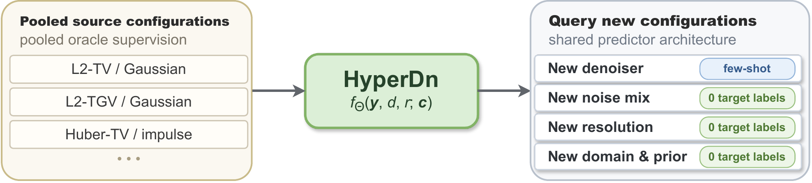
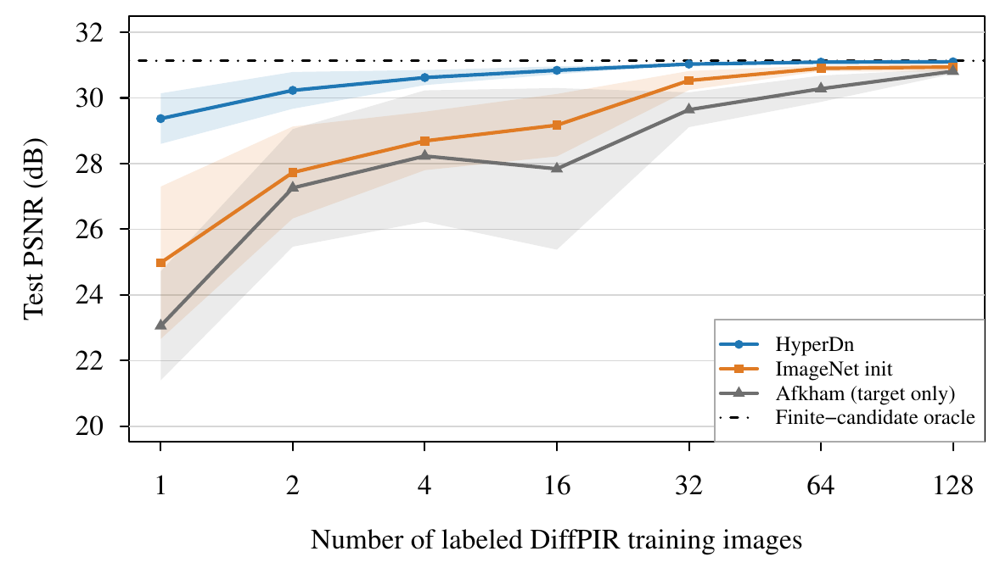
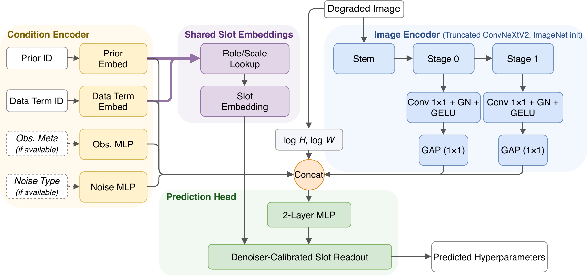

<div align="center">

# Oracle Supervision Transfers for Hyperparameter Prediction in Model-Based Image Denoising

**HyperDn** · NeurIPS 2026

**Jianmin Liao · Lixin Shen · Yuesheng Xu**

[](https://arxiv.org/abs/2605.20479) [](https://openreview.net/forum?id=vXGWG7Z20k) [](https://github.com/JianminLiao/HyperDn-NeurIPS2026/actions/workflows/checks.yml) [](LICENSE) [](THIRD_PARTY_NOTICES.md)

</div>

<p align="center">
  
</p>

**TL;DR:** Oracle hyperparameter labels transfer across denoising configurations, so new configurations need few or no labels.

Model-based denoisers such as TV, TGV, NLM, CBM3D and diffusion-based DiffPIR depend strongly on image-dependent hyperparameters. A learned predictor can choose them well, but it usually needs its own oracle labels for every new configuration, and each label is a search scored against the clean image. **HyperDn** is a single configuration-conditioned predictor. It pools 119,444 oracle labels from 13 cheap TV/TGV source configurations, then predicts the hyperparameters of a new configuration in one forward pass.

- **Few-shot transfer to a new denoiser.** From TV/TGV sources to DiffPIR, 2 DiffPIR labels match Afkham et al. trained on 64 (30.23 vs. 30.28 dB; oracle 31.13 dB). With 32 labels, HyperDn is within 0.10 dB PSNR, 0.006 SSIM or 0.021 LPIPS of the oracles. For NLM and CBM3D, whose hyperparameters mean something different, 2 labels give +3.73 and +3.95 dB over Afkham et al.
- **Zero-shot transfer.** With no target labels, HyperDn stays within 0.21 dB of the oracle on unseen mixtures of seen noise types and within 0.27 dB on images up to about 1024×768 after training mostly on 96×96 images. On FFHQ faces with an FFHQ diffusion prior, it is 0.27 dB from the oracle using no FFHQ labels (after adapting on 128 WED DiffPIR labels with an ImageNet prior).
- **Fast.** Prediction takes 0.78 ms per 256×256 image (batched), 150–300× faster than selecting λ with SURE.

Label counts are the labels used to fit the predictor. All methods fix DiffPIR's ζ = 1, which was optimal for all 4,344 training images in a preliminary sweep.

<p align="center">
  
  <br>
  <em>Few-shot DiffPIR transfer on WED 256×256 crops: mean test PSNR (±std) vs. number of DiffPIR labels; oracle&nbsp;31.13&nbsp;dB.</em>
</p>

## Installation

```bash
git clone https://github.com/JianminLiao/HyperDn-NeurIPS2026.git
cd HyperDn-NeurIPS2026
python3.12 -m venv .venv
source .venv/bin/activate
pip install -r requirements.txt
```

Inference runs on CPU. A CUDA GPU is recommended for training and for DiffPIR.

## Quick start

Predict the CBM3D parameter for the included synthetic noisy image and denoise it:

```bash
python infer.py --algorithm cbm3d --image examples/noisy.png \
  --output outputs/cbm3d.png --json outputs/cbm3d.json
```

The command prints the predicted parameter and saves the restored image. Replace `examples/noisy.png` with your own noisy RGB image. The predictor is told the noise type (Gaussian) but needs neither the noise level nor a clean reference.

Predict the DiffPIR parameter (no diffusion prior needed for prediction only):

```bash
python infer.py --algorithm diffpir --image examples/noisy.png
```

## Pretrained models

The checkpoints are included in the repository. The DiffPIR and CBM3D models were adapted from the source model with two target labels (seed 43).

| Model | Checkpoint | Predicts |
|---|---|---|
| Source | `checkpoints/hyperdn_source_s43.pt` | TV/TGV parameters for the 13 source configurations |
| DiffPIR (WED, PSNR labels) | `checkpoints/hyperdn_diffpir_2shot_s43.pt` | `lambda_eff = lambda_cache · sigma²`, with `zeta = 1` |
| CBM3D | `checkpoints/hyperdn_cbm3d_2shot_s43.pt` | `sigma_psd` in `[0, 1]` image units, clipped to `[0.003, 0.30]` |

`infer.py` loads the matching checkpoint by default. Use `--checkpoint PATH` to load another one.

## Denoising with DiffPIR

Parameter prediction works out of the box. To also run DiffPIR, install the official solver and its ImageNet prior (about 2.1 GiB):

```bash
git clone https://github.com/yuanzhi-zhu/DiffPIR.git external/DiffPIR_official
git -C external/DiffPIR_official checkout 2a9898129a1b274131b98746e5b364bc20adc1e1
mkdir -p external/DiffPIR_official/model_zoo
curl -fL https://openaipublic.blob.core.windows.net/diffusion/jul-2021/256x256_diffusion_uncond.pt \
  -o external/DiffPIR_official/model_zoo/256x256_diffusion_uncond.pt
```

Then denoise a 256×256 RGB image (100 iterations by default):

```bash
python infer.py --algorithm diffpir --image noisy256.png --device cuda --output restored.png
```

Other options: `--diffpir-root`, `--diffpir-prior`, `--diffpir-device`, `--diffpir-iterations`, and `--seed`.

## Training and few-shot transfer

**1. Prepare data.** Download STL-10 and the Waterloo Exploration Database (WED) as described in [docs/data.md](docs/data.md), then unpack the included oracle labels into `dataset_labels/source/` and `dataset_labels/target/`:

```bash
python scripts/prepare_labels.py
```

**2. Source pretraining** on the 13 pooled TV/TGV label banks. You can skip this step and adapt the released source checkpoint directly.

```bash
python pretrain_source.py
```

**3. Few-shot transfer** to DiffPIR and CBM3D:

```bash
python fewshot_diffpir.py   # DiffPIR on WED, PSNR labels
python fewshot_cbm3d.py     # CBM3D
```

Each script trains and evaluates HyperDn (`ours`), ImageNet initialization (`imagenet_init`) and Afkham et al. (`afkham`) with 1, 2, 4, 16, 32, 64 and 128 target labels, seed 43 by default. To run only two-label HyperDn:

```bash
DIFFPIR_METHODS=ours DIFFPIR_SHOTS=2 python fewshot_diffpir.py
CBM3D_METHODS=ours CBM3D_SHOTS=2 python fewshot_cbm3d.py
```

<details>
<summary>More options</summary>

| Variable | Effect |
|---|---|
| `DIFFPIR_ONLY_EVAL=1`, `CBM3D_ONLY_EVAL=1` | Evaluate saved checkpoints, including the released two-label models |
| `PRETRAIN_SEEDS`, `DIFFPIR_SEEDS`, `CBM3D_SEEDS` | Comma-separated seeds, e.g. `42,43,44,45,46`; few-shot runs need a source model for each seed |
| `PRETRAIN_OUTPUT_ROOT`, `DIFFPIR_OUTPUT_ROOT`, `CBM3D_OUTPUT_ROOT` | Output directories; use a new one when changing settings |
| `DEVICE=cpu` | Run evaluation on the CPU, e.g. on Apple silicon, where PyTorch's MPS backend lacks an adaptive-pooling case HyperDn needs |

Evaluation uses 50 WED validation images. Target oracle labels are included; [docs/data.md](docs/data.md#target-oracle-generation) explains how to regenerate them with `scripts/generate_oracles.py`.

</details>

## Repository layout

| Path | Contents |
|---|---|
| `infer.py` | Predict the hyperparameters for one image, and optionally denoise it |
| `pretrain_source.py` | Source pretraining on the 13 TV/TGV label banks |
| `fewshot_diffpir.py`, `fewshot_cbm3d.py` | Few-shot transfer and evaluation |
| `fewshot_protocol.py`, `experiment_runner.py` | Shared few-shot protocol and run bookkeeping |
| `train_hyperdn.py`, `evaluate_hyperdn.py` | Training and evaluation, called by the scripts above |
| `hyperdn_model.py`, `hyperdn_dataset.py`, `dataset.py`, `checkpoint_utils.py` | Model, oracle-label datasets and checkpoint loading |
| `afkham_baseline.py`, `train_afkham_baseline.py` | Afkham et al. baseline |
| `create_imagenet_init_checkpoint.py` | ImageNet-initialization baseline |
| `find_optimal_diffpir_denoise.py`, `find_optimal_cbm3d_denoise.py`, `merge_diffpir_denoise_shards.py` | Oracle label searches, run through `scripts/generate_oracles.py` |
| `aggregate_fewshot_cbm3d.py` | Merge CBM3D results from parallel workers |
| `summary_writer.py` | Optional TensorBoard logging |
| `restoration/` | Solvers, noise models, metrics and parameter encodings |
| `scripts/` | Data preparation and oracle label generation |
| `configs/` | Label-bank manifest, WED split and oracle recipes |

## Architecture

<p align="center">
  
</p>

A truncated ConvNeXtV2 encoder extracts features from the degraded image. A condition encoder embeds the denoiser (prior and data term) and, when available, the noise type and observation metadata. A shared prediction head reads out the hyperparameters of the queried configuration.

## Citation

```bibtex
@inproceedings{liao2026oracle,
  title         = {Oracle Supervision Transfers for Hyperparameter Prediction in Model-Based Image Denoising},
  author        = {Liao, Jianmin and Shen, Lixin and Xu, Yuesheng},
  booktitle     = {Advances in Neural Information Processing Systems},
  year          = {2026},
  eprint        = {2605.20479},
  archivePrefix = {arXiv},
  primaryClass  = {cs.CV},
  url           = {https://arxiv.org/abs/2605.20479}
}
```

## License and acknowledgments

The code is released under the [MIT license](LICENSE). The pretrained weights derive from ConvNeXt V2 and are released under CC BY-NC 4.0; see [third-party notices](THIRD_PARTY_NOTICES.md).

We thank the authors of [ConvNeXt V2](https://github.com/facebookresearch/ConvNeXt-V2), [timm](https://github.com/huggingface/pytorch-image-models), [DiffPIR](https://github.com/yuanzhi-zhu/DiffPIR), and [BM3D](https://pypi.org/project/bm3d/) for releasing their code and models.

Questions about the code are welcome as [GitHub issues](https://github.com/JianminLiao/HyperDn-NeurIPS2026/issues).
