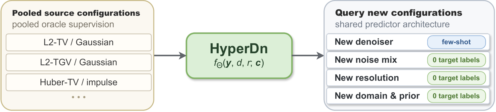
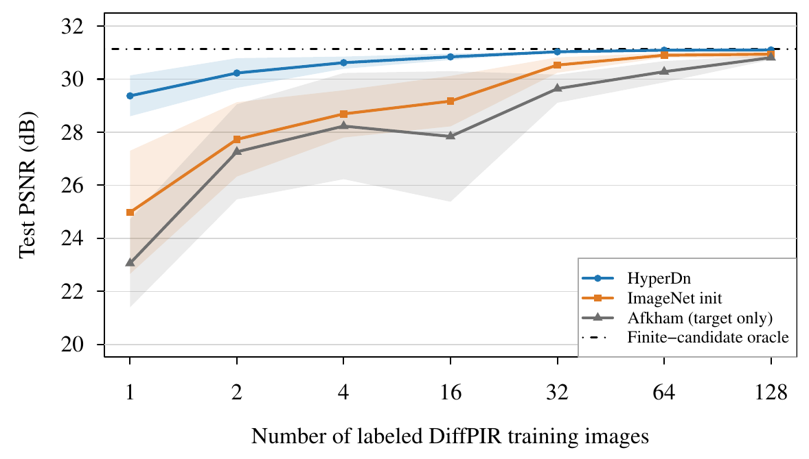
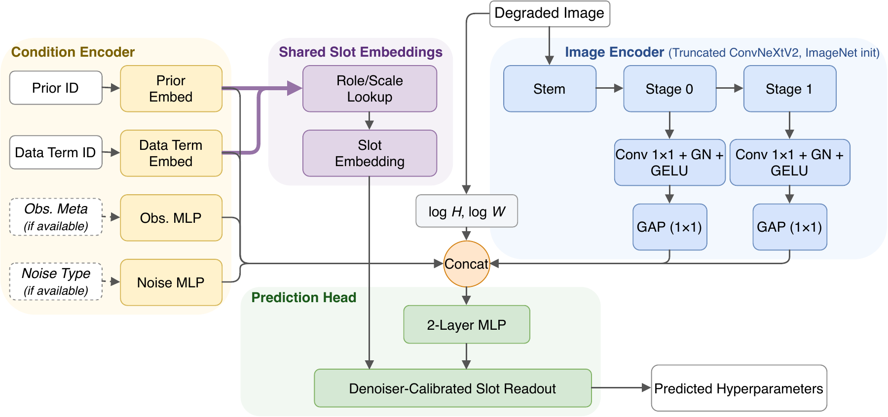

<div align="center">

# HyperDn

### Oracle Supervision Transfers for Hyperparameter Prediction in Model-Based Image Denoising

**Jianmin Liao · Lixin Shen · Yuesheng Xu**

NeurIPS 2026

[](https://arxiv.org/abs/2605.20479) [](https://openreview.net/forum?id=vXGWG7Z20k) [](https://github.com/JianminLiao/HyperDn-NeurIPS2026/actions/workflows/checks.yml) [](LICENSE) [](THIRD_PARTY_NOTICES.md)

</div>

<p align="center">
  
</p>

Choosing hyperparameters for a model-based denoiser usually means building an oracle-labeled training set for every new configuration. **HyperDn** is a single configuration-conditioned predictor that pools oracle supervision across source configurations (TV/TGV solvers under different noise models) and reuses it for new denoisers and noise settings with few or no target labels.

- **Few-shot transfer to a new denoiser.** From TV/TGV sources to diffusion-based DiffPIR, HyperDn uses 2 target labels for predictor fitting (after a shared configuration calibration), comes within 0.90 dB of the oracle, and matches the 64-label Afkham et al. baseline trained from scratch. Transfer also holds for SSIM and LPIPS oracle labels, and for NLM and CBM3D.
- **Zero-shot transfer.** Without target oracle labels, HyperDn reaches near-oracle PSNR on unseen mixtures of seen noise types, on images up to about 1024×768 after training mostly on 96×96 images, and under a joint shift in image domain and diffusion prior.

<p align="center">
  
  <br>
  <em>Few-shot DiffPIR transfer on WED 256×256 crops: mean test PSNR (±std) vs. target labels; oracle&nbsp;31.13&nbsp;dB.</em>
</p>

## Installation

```bash
git clone https://github.com/JianminLiao/HyperDn-NeurIPS2026.git
cd HyperDn-NeurIPS2026
python3.12 -m venv .venv
source .venv/bin/activate
pip install -r requirements.txt
```

Inference runs on CPU. A CUDA GPU is recommended for training and for DiffPIR.

## Quick start

Predict the CBM3D parameter for the included synthetic noisy image and denoise it:

```bash
python infer.py --algorithm cbm3d --image examples/noisy.png \
  --output outputs/cbm3d.png --json outputs/cbm3d.json
```

The command prints the predicted parameter and saves the restored image. Replace `examples/noisy.png` with your own noisy RGB image. The predictor is told the noise type (Gaussian) but needs neither the noise level nor a clean reference.

Predict the DiffPIR parameter (no diffusion prior needed for prediction only):

```bash
python infer.py --algorithm diffpir --image examples/noisy.png
```

## Pretrained models

The checkpoints are included in the repository. The target models were adapted with two target labels.

| Model | Checkpoint | Output |
|---|---|---|
| Source pretrained | `checkpoints/hyperdn_source_s43.pt` | TV/TGV source configurations |
| DiffPIR (WED, PSNR) | `checkpoints/hyperdn_diffpir_2shot_s43.pt` | `lambda_eff = lambda_cache · sigma²`, with `zeta = 1` |
| CBM3D | `checkpoints/hyperdn_cbm3d_2shot_s43.pt` | `sigma_psd` in `[0, 1]` image units, clipped to `[0.003, 0.30]` |

`infer.py` loads the matching checkpoint by default. Use `--checkpoint PATH` to load another one.

## Denoising with DiffPIR

Parameter prediction works out of the box. To also run DiffPIR, install the official solver and its ImageNet prior (about 2.1 GiB):

```bash
git clone https://github.com/yuanzhi-zhu/DiffPIR.git external/DiffPIR_official
git -C external/DiffPIR_official checkout 2a9898129a1b274131b98746e5b364bc20adc1e1
mkdir -p external/DiffPIR_official/model_zoo
curl -fL https://openaipublic.blob.core.windows.net/diffusion/jul-2021/256x256_diffusion_uncond.pt \
  -o external/DiffPIR_official/model_zoo/256x256_diffusion_uncond.pt
```

Then denoise a 256×256 RGB image (100 iterations by default):

```bash
python infer.py --algorithm diffpir --image noisy256.png --device cuda --output restored.png
```

Other options: `--diffpir-root`, `--diffpir-prior`, `--diffpir-device`, `--diffpir-iterations`, and `--seed`.

## Training and few-shot transfer

**1. Prepare data.** Download STL-10 and the Waterloo Exploration Database (WED) as described in [docs/data.md](docs/data.md), then unpack the included oracle labels:

```bash
python scripts/prepare_labels.py
```

**2. Source pretraining** on the pooled TV/TGV oracle labels. You can skip this step and adapt the released source checkpoint directly.

```bash
python run_fullcorpus_kendall_5seed.py
```

**3. Few-shot transfer** to DiffPIR and CBM3D:

```bash
python run_expc_fullcorpus_kendall.py   # DiffPIR, WED/PSNR
python run_expc_cbm3d_unknown.py        # CBM3D
```

By default, each script runs seed 43 for HyperDn, ImageNet initialization, and the target-only Afkham et al. baseline with 1, 2, 4, 16, 32, 64, and 128 target labels. To train or evaluate only two-shot HyperDn:

```bash
EXPC_METHODS=ours EXPC_SHOTS=2 python run_expc_fullcorpus_kendall.py
CBM3D_METHODS=ours CBM3D_SHOTS=2 python run_expc_cbm3d_unknown.py
```

<details>
<summary>More options</summary>

| Variable | Effect |
|---|---|
| `EXPC_ONLY_EVAL=1`, `CBM3D_ONLY_EVAL=1` | Evaluate saved checkpoints, including the released two-shot models |
| `FC_SEEDS`, `EXPC_SEEDS`, `CBM3D_SEEDS` | Comma-separated seeds, e.g. `42,43,44,45,46`; adaptation needs a source model for each seed |
| `FC_OUTPUT_ROOT`, `EXPC_OUTPUT_ROOT`, `CBM3D_OUTPUT_ROOT` | Output directories; use a new one when changing settings |

Evaluation uses 50 WED validation images. Target oracle labels are included; [docs/data.md](docs/data.md#target-oracle-generation) explains how to regenerate them with `scripts/generate_oracles.py`.

</details>

## Architecture

<p align="center">
  
</p>

A truncated ConvNeXtV2 encoder extracts features from the degraded image. A condition encoder embeds the denoiser (prior and data term) and, when available, the noise type and observation metadata. A shared prediction head reads out the hyperparameters of the queried configuration.

## Citation

```bibtex
@inproceedings{liao2026oracle,
  title     = {Oracle Supervision Transfers for Hyperparameter Prediction in Model-Based Image Denoising},
  author    = {Liao, Jianmin and Shen, Lixin and Xu, Yuesheng},
  booktitle = {Advances in Neural Information Processing Systems},
  year      = {2026},
  url       = {https://openreview.net/forum?id=vXGWG7Z20k}
}
```

## License and acknowledgments

The code is released under the [MIT license](LICENSE). The pretrained weights derive from ConvNeXt V2 and are released under CC BY-NC 4.0; see [third-party notices](THIRD_PARTY_NOTICES.md).

We thank the authors of [ConvNeXt V2](https://github.com/facebookresearch/ConvNeXt-V2), [timm](https://github.com/huggingface/pytorch-image-models), [DiffPIR](https://github.com/yuanzhi-zhu/DiffPIR), and [BM3D](https://pypi.org/project/bm3d/) for releasing their code and models.

Questions about the code are welcome as [GitHub issues](https://github.com/JianminLiao/HyperDn-NeurIPS2026/issues).
